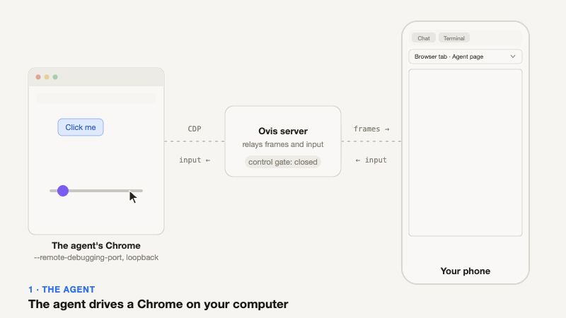
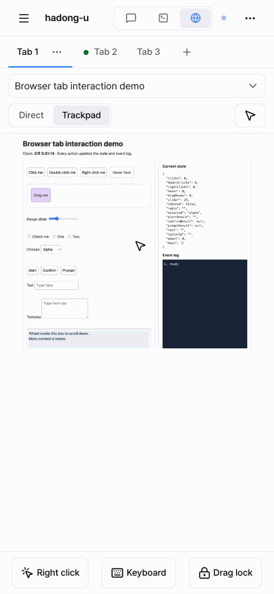
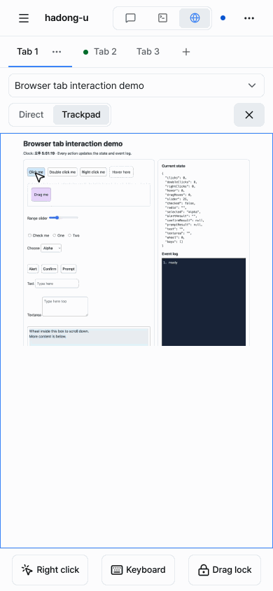
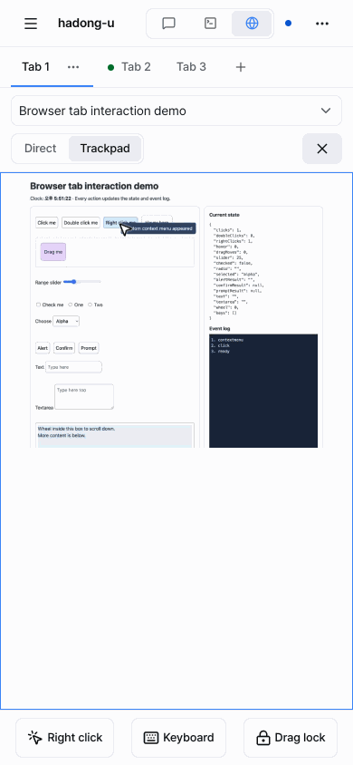
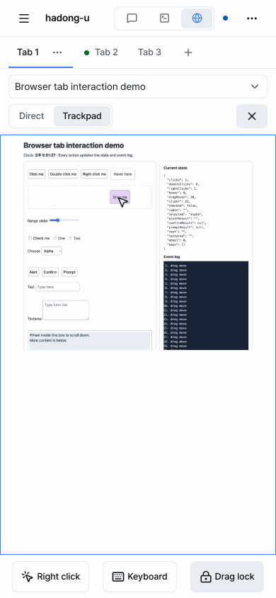
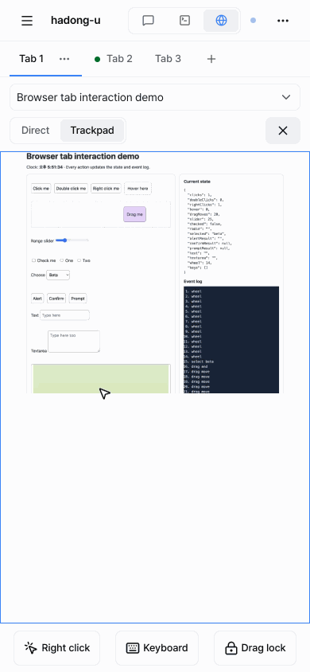

<p align="center">
  
</p>

<h1 align="center">Ovis with Browser</h1>

<p align="center">
  <strong>에이전트가 쓰는 브라우저를, 채팅과 터미널 옆 탭에서.</strong>
</p>

<p align="center">
  <a href="README.md">English</a> · <strong>한국어</strong>
</p>

[Ovis](https://github.com/devswha/ovis)를 포크한 프로젝트입니다. Ovis는 [herdr](https://github.com/herdrdev/herdr)의 브라우저·모바일 클라이언트이고, 기존 기능은 모두 그대로 있습니다. 이 포크가 더하는 것은 하나, **Browser** 탭입니다. 코딩 에이전트가 Chrome으로 작업하면 그 Chrome 탭을 Ovis에서 그대로 보고, 컴퓨터에서든 모바일 기기에서든 에이전트가 막혔을 때 직접 이어받을 수 있습니다.

설치, 에이전트, 채팅, 터미널, 푸시 알림, 원격 PC 같은 나머지는 [Ovis README](https://github.com/devswha/ovis#readme)와 [사용자 가이드](https://github.com/devswha/ovis/blob/main/docs/guide.md)를 보세요. 이 문서는 포크가 더한 부분만 다룹니다.

## 무엇을 하나

- **Browser 탭**: Chat, Terminal 옆에 생깁니다. 에이전트가 Chrome을 쓰는 pane에서, 그 Chrome이 pane에 등록되면 나타납니다.
- **에이전트가 쓰는 바로 그 탭**을 실시간으로 보고, 그 안에서 클릭하고 입력합니다. 탭 선택기로 열린 탭을 고릅니다.
- **원할 때만 제어권을 가져옵니다.** 처음에는 보기 전용이고, 첫 클릭이나 키 입력이 제어권을 가져옵니다(그 입력은 페이지로 가지 않음). **Esc**, 해제 버튼, 60초 무입력이면 돌아갑니다. 스크롤은 제어권을 가져오지 않습니다.
- **모바일 기기용**: 터치 화면이 트랙패드가 됩니다. 손가락 하나로 커서를 움직이고, 탭하면 클릭, 두 손가락 탭은 우클릭, 두 손가락 이동은 스크롤, 탭 후 드래그는 드래그입니다.
- **메뉴와 대화상자**: Chrome의 `<select>` 목록과 JavaScript `alert`, `confirm`, `prompt`는 화면 스트림에 잡히지 않아서 Ovis가 직접 그려 줍니다.

<p align="center">
  
</p>

## 설치

같은 컴퓨터에 [herdr](https://github.com/herdrdev/herdr), [Bun](https://bun.sh), 데스크톱 Chrome이 필요합니다. macOS와 Linux에서 테스트했고 **Windows는 아직 테스트하지 않았습니다.**

```bash
bun add -g ovis-with-browser
ovis-with-browser setup
```

`setup`이 이 포크를 herdr 플러그인으로 설치하고 `http://127.0.0.1:7318`에서 시작한 뒤, 에이전트 skill을 설치할지(에이전트가 자기 Chrome을 직접 등록하게 함), Tailscale로 모바일 기기에서 열지를 묻습니다. 설치된 Ovis와 함께 돌아가며 그쪽은 건드리지 않습니다. [직접 설치, 플래그, 나머지 →](docs/details.ko.md)

브라우저가 필요한 herdr pane의 에이전트는 `ovis-browser start`를 실행합니다. 그 pane의 **Browser** 탭을 열어 보고 조작하세요.

## 모바일 기기에서

터치 기기에서는 Browser 탭이 **Trackpad** 모드로 열립니다. 페이지 영역이 터치패드가 되고, 커서가 탭이 닿을 위치를 보여 줍니다. 옆의 **Direct** 모드는 마우스처럼 포인터를 그대로 보냅니다. 선택은 기기마다 기억됩니다. 페이지 아래 막대에는 **Right click**, **Keyboard**(키보드 열기), **Drag lock**이 있습니다.

<table>
  <tr>
    <td width="50%" valign="top"><b>1. 제어권 가져오기와 이동</b><br>한 번 탭하면 제어권을 가져옵니다. 이 첫 탭은 페이지로 가지 않습니다. 그다음 손가락 하나로 끌면 커서가 따라오고 hover도 동작합니다.</td>
    <td width="50%" valign="top"><b>2. 클릭과 우클릭</b><br>탭하면 커서 위치를 클릭합니다. 두 손가락 탭은 우클릭이고, Right click 버튼도 같습니다.</td>
  </tr>
  <tr>
    <td align="center"></td>
    <td align="center"></td>
  </tr>
  <tr>
    <td width="50%" valign="top"><b>3. 드래그</b><br>탭한 뒤 바로 다시 터치해서 움직이면 잡아서 끕니다. 길거나 정밀한 드래그는 Drag lock을 켜고 움직인 뒤 끄면 놓습니다.</td>
    <td width="50%" valign="top"><b>4. 메뉴와 스크롤</b><br>select 목록은 커서 위치에 열리고, alert·confirm·prompt는 대화상자로 나옵니다. 두 손가락을 위아래로 움직이면 스크롤되며 제어권을 가져오지 않습니다.</td>
  </tr>
  <tr>
    <td align="center"></td>
    <td align="center"></td>
  </tr>
  <tr>
    <td width="50%" valign="top"><b>5. 놓기와 탭 전환</b><br>X 버튼(또는 Esc, 60초 무입력)이 제어권을 돌려줍니다. 탭 선택기는 아래에서 올라오는 시트로 열리고, 백그라운드 탭은 Show this tab 카드로 나옵니다.</td>
    <td width="50%" valign="top"></td>
  </tr>
  <tr>
    <td align="center"></td>
    <td></td>
  </tr>
</table>

## 더 보기

[상세 문서](docs/details.ko.md): 직접 설치, 플래그, 헬퍼와 skill, Chrome 직접 등록, 동작 방식, 한계.

Ovis는 MIT 라이선스입니다. [LICENSE](LICENSE)를 보세요.
