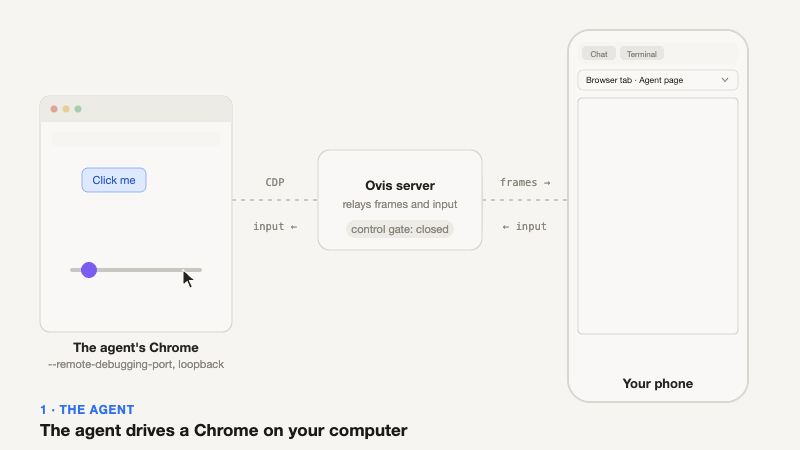
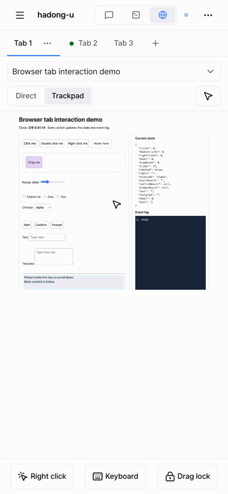
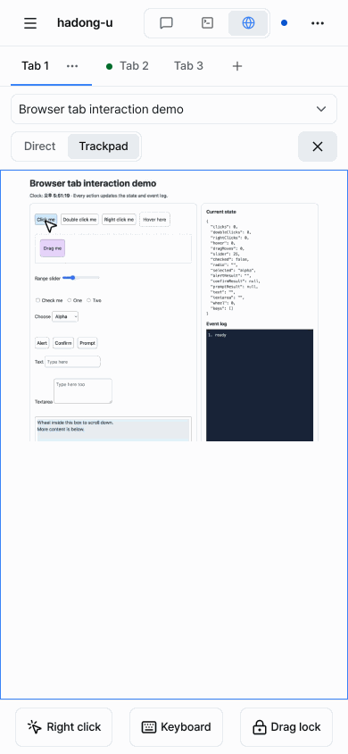
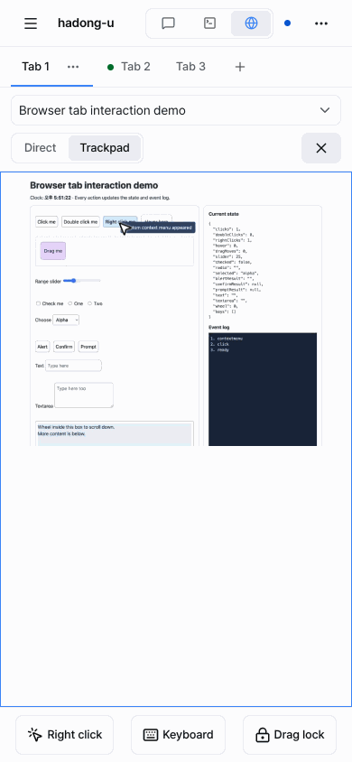
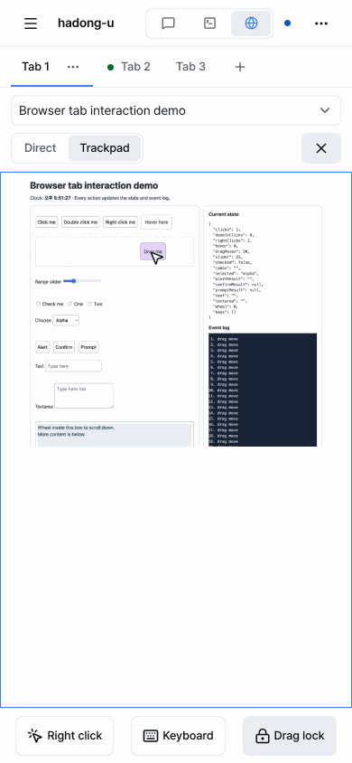
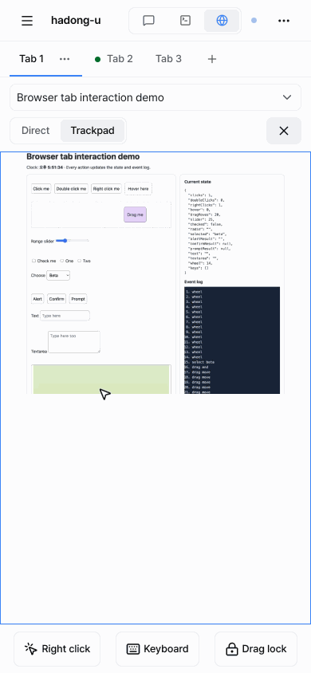

<p align="center">
  
</p>

<h1 align="center">Ovis with Browser</h1>

<p align="center">
  <strong>The browser an agent drives, in a tab next to its chat and terminal.</strong>
</p>

A fork of [Ovis](https://github.com/devswha/ovis), the browser and phone client for [herdr](https://github.com/herdrdev/herdr). Everything Ovis does is still here; this fork adds one thing: a **Browser** tab. When a coding agent works in a Chrome, you see that same Chrome tab live in Ovis, on your computer or on your phone, and you can take over when the agent needs a hand.

For everything else (install, agents, chat, terminal, push alerts, remote PCs) see the [Ovis README](https://github.com/devswha/ovis#readme) and its [user guide](https://github.com/devswha/ovis/blob/main/docs/guide.md). This README covers only what the fork adds.

## what it does

- **A Browser tab** next to Chat and Terminal, for a pane whose agent drives a Chrome. It appears when that Chrome is registered for the pane.
- **The same tab the agent uses.** Ovis streams the Chrome tab (Chrome DevTools Protocol screencast) and sends your clicks and keys back. A tab picker lists the open tabs.
- **Take control only when you mean to.** The view starts read-only. The first click or key takes control and is not forwarded to the page; **Esc**, the release button or 60 seconds without input give control back. Scrolling never takes control.
- **Built for a phone.** On a touch device the tab opens in **Trackpad** mode: one finger moves a cursor (hover works), a tap clicks, two fingers tap to right-click or move to scroll, tap and drag drags. A bar below adds right click, a keyboard button and a drag lock. **Direct** mode sends the pointer as it is, for a mouse.
- **Menus and dialogs that work.** Chrome's native `<select>` list and JavaScript `alert`, `confirm` and `prompt` cannot be screencast, so Ovis draws them and sends your answer back.
- **Background tabs without surprises.** Chrome does not paint a hidden tab. Picking one shows a card with **Show this tab** (takes control and brings the tab forward) and **Back**. Looking at a tab never raises the Chrome window.

## how it works

<p align="center">
  
</p>

1. **Chrome runs on your computer.** The agent's Chrome has a debugging port on loopback. Ovis does not launch it: the agent starts it through the helper (see below) or you do.
2. **Register it for a pane.** The Ovis server keeps the Chrome's address for that herdr pane in memory and shows a Browser tab for it. The server is Ovis's own, with one module added for this ([server/browser-sessions.ts](server/browser-sessions.ts)); there is no second server.
3. **Frames go out.** The server asks Chrome for a screencast of one tab and sends each frame to the browser or phone that has the tab open. Phones get smaller, lower quality frames.
4. **Input comes back.** Your clicks, moves, scrolls and keys go to the server and are replayed in Chrome. Pointer moves are coalesced, so only the latest one is sent while a request is in flight.
5. **Control is explicit.** The view starts read-only. The first tap or key takes control, and is not sent to the page. Esc, the release button or 60 seconds without input give it back.

## use it

You need herdr, [Bun](https://bun.sh) and a desktop Chrome on the same computer as Ovis. Headless Chrome is not supported yet.

```bash
git clone https://github.com/icingrain/ovis-with-browser.git
cd ovis-with-browser
bun install
bun run build
bun run server        # http://127.0.0.1:7317; add HOST=$(tailscale ip -4) to open it from a phone
```

### let the agent register its own Chrome (recommended)

Install the skill once. It tells Claude Code, Codex and OpenCode to start their Chrome through `scripts/ovis-browser.ts`, which launches a Chrome with its own profile and registers it for the pane the agent runs in (`$HERDR_PANE_ID`).

```bash
bun scripts/install-browser-skill.ts          # shows what it would write, writes nothing
bun scripts/install-browser-skill.ts --yes    # installs ovis-browser into each agent folder found
bun scripts/install-browser-skill.ts --remove --yes
```

If you run Ovis as a herdr plugin, the same install is the plugin action **Install the Browser tab skill**. It writes `skills/ovis-browser/SKILL.md` under `~/.claude`, `~/.codex` and `~/.config/opencode`, only where that agent's folder exists (`--agent claude|codex|opencode` forces one), and only replaces files it wrote itself. Restart running agent sessions afterwards.

From then on, an agent in a pane that needs a browser runs `ovis-browser start`, drives the printed `cdp_url`, and you open the pane's **Browser** tab. The helper reads `OVIS_URL` (default `http://127.0.0.1:7317`) and `OVIS_TOKEN` when the server asks for one.

```bash
bun scripts/ovis-browser.ts start --url https://example.com   # launch or reuse this pane's Chrome and register it
bun scripts/ovis-browser.ts status
bun scripts/ovis-browser.ts stop                               # unregister and close it
```

### or register one by hand

1. Start Chrome with a debugging port on loopback:
   ```bash
   chrome --remote-debugging-port=9222 --remote-debugging-address=127.0.0.1 --user-data-dir=/tmp/agent-chrome
   ```
2. Register it for a pane. Inside a pane the ID is `$HERDR_PANE_ID`; elsewhere `herdr pane list` prints them.
   ```bash
   curl -X POST 'http://127.0.0.1:7317/api/pane/browser/register' \
     -H 'content-type: application/json' \
     --data '{"pane_id":"w1:p1","cdp_url":"http://127.0.0.1:9222"}'
   ```
   Only `http://127.0.0.1:<port>` endpoints are accepted. `DELETE /api/pane/browser?pane_id=w1:p1` unregisters. The registration lives in the server's memory, so a restart needs it again. A server that asks for a token or a paired device needs `Authorization: Bearer <token>` on these calls.
3. Open the pane in Ovis and pick **Browser**.

`bun scripts/browser-tab-demo.ts --pane-id=<pane id>` opens a Chrome with an interaction test page and prints the register command, which is the quickest way to try it.

## on a phone

On a touch device the Browser tab opens in **Trackpad** mode: the page area is a touchpad, and a cursor shows where a tap will land. The **Direct** mode next to it sends the pointer as it is, for a mouse. The choice is remembered per device.

**1. Take control and move.** Tap once to take control; that first tap is not sent to the page. Then drag one finger: the cursor follows, and hover effects work.

<p align="center">
  
</p>

**2. Click and right-click.** A tap clicks where the cursor is. A tap with two fingers right-clicks; the Right click button below does the same.

<p align="center">
  
</p>

**3. Drag.** Tap, then touch again straight away and move to grab and drag. For a long or precise drag, turn **Drag lock** on, move, and turn it off to let go.

<p align="center">
  
</p>

**4. Menus and scrolling.** A page's select list opens at the cursor and is tapped like any menu; JavaScript alert, confirm and prompt dialogs appear as dialogs. Two fingers moving up or down scroll the page and never take control.

<p align="center">
  
</p>

**5. Let go and switch tabs.** The X button (or Esc, or 60 seconds without input) gives control back. The tab picker rises from the bottom as a sheet; a tab Chrome keeps in the background shows a card with **Show this tab**, which takes control and brings it forward.

<p align="center">
  
</p>

The bar under the page has **Right click**, **Keyboard** (opens the phone keyboard) and **Drag lock**.

## limits

- Chrome has to run on the same computer as the Ovis server, as a desktop (not headless) Chrome; a pane on a remote PC has no Browser tab.
- Native date, color and file pickers, paste and IME composition are not relayed.
- What you see is a stream: a page's reaction reaches the screen after the network round trip plus Chrome's capture and encode time. Phones receive smaller, lower quality frames to keep up.
- The registered Chrome is fully controllable by anyone who can open Ovis, so the usual Ovis access rules (token, paired devices, Tailscale) are the protection. Register only a Chrome you are willing to share.

## how the fork is kept

- `upstream-sync` mirrors `devswha/ovis` `main` and is never committed to.
- `main` is `upstream-sync` plus the Browser tab, rebased after each upstream update.
- The Browser tab lives in `server/browser-sessions.ts`, `src/components/BrowserView.*`, `src/lib/browser*.ts` and `scripts/browser-tab-*`; the rest of the diff is thin wiring (the `PaneView` type, the pane lens, the header button, translations).

Ovis is MIT licensed; see [LICENSE](LICENSE).
